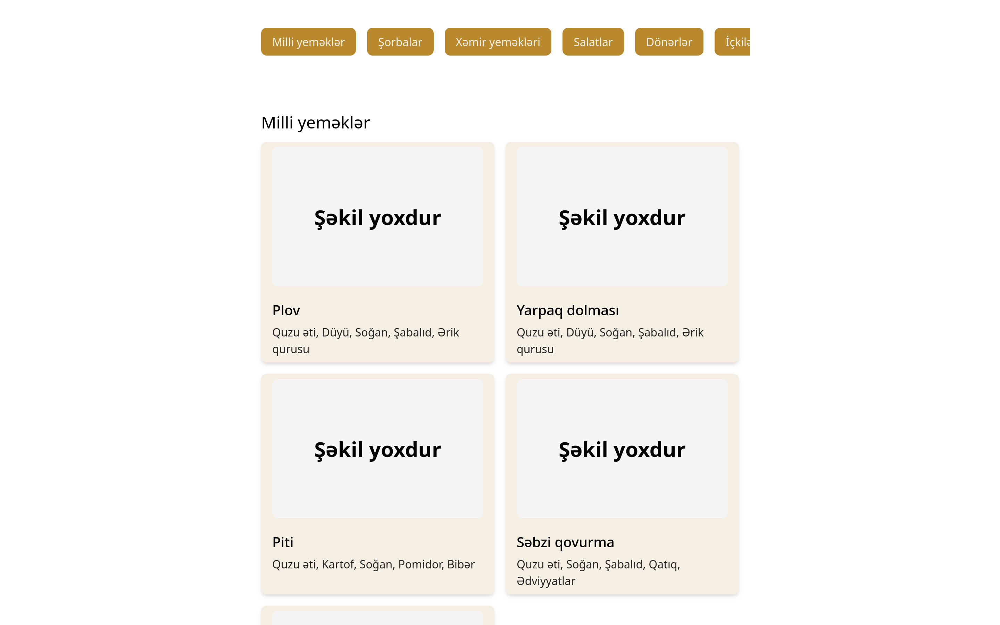

# QR Food Menu

## 🌐 Demo:
https://qr-food-menu.netlify.app/

## 📎 Referances:
- For color combos: [https://colorhunt.co/palette/f5efe34f5b2ab8892dd8c9a8] ‒ Color Hunt;
- Object.entires(): [https://medium.com/@artemkhrenov/javascript-grouping-methods-object-groupby-and-map-groupby-5bcb0e2134bf] ‒ JavaScript Grouping Methods: Object.groupBy() and Map.groupBy() - Artem Khrienov; [https://developer.mozilla.org/en-US/docs/Web/JavaScript/Reference/Global_Objects/Object/entries] ‒ Object.entries - MDN;
